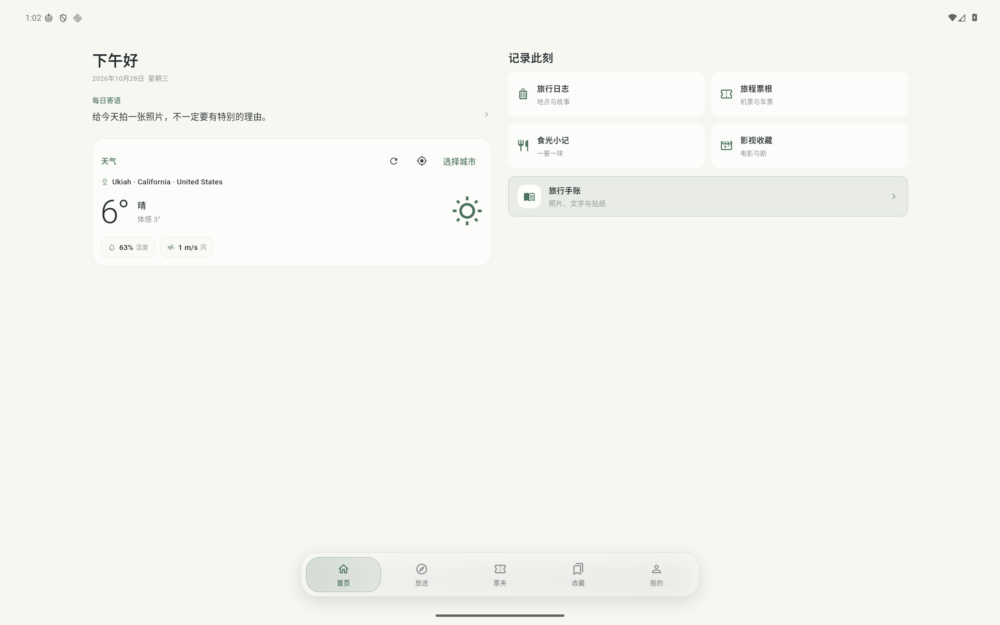
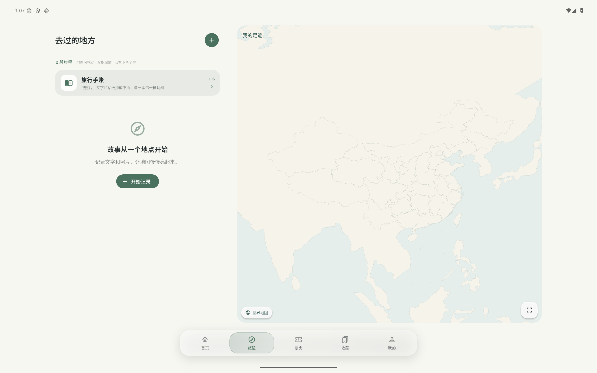
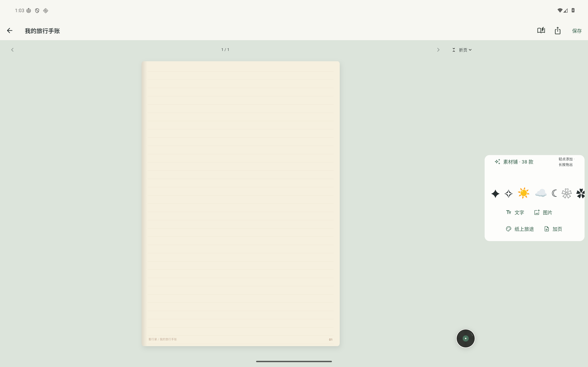

<div align="center">


# Waylore · 客行录

**Keep your journeys. Remember your everyday.**

A local-first travel and life journal for Windows, Android phones and Android tablets.

[简体中文](README.md) · [Installation and data](docs/UNIFIED-RELEASE.md) · [Support](docs/SUPPORT.md)
</div>

## A familiar space across devices

The new Windows, phone and Android tablet clients share the Flutter application in `mobile/`. All public version names remain **1.0.0**. Android uses an increasing internal build number for upgrades.

- **Travel journals:** save places, dates, stories and photos; revisit your memories on an offline vector map. Routes are illustrative, not navigation directions.
- **Travel tickets:** keep flight and rail memories, flip each ticket and view its route. Decorative tickets are not valid boarding or travel documents.
- **Creative notebooks:** arrange text, photos, 38 original graphic stickers and quick symbols across 12 paper styles. Choose smooth, folding, book or fade transitions. Landscape editing uses a side toolbar.
- **Music for memories:** 12 offline instrumental tracks plus MP3 import up to50MB. Music is selected per notebook or travel entry and plays when opened. Tap the floating record to reveal seeking, volume, looping and track selection.
- **Food and film:** preserve meals, posters, up to three leading actors, ratings and personal notes. New collections default to five stars. Online film metadata may need correction.
- **Daily wishes and birthdays:** a short daily message on the home screen, selected Chinese and international holidays, and birthday greetings. Birthday splash appears on each opening that day; homepage confetti appears once per local day, account and device.
- **Personal appearance:** themes, cover backgrounds, system fonts, bundled serif and handwriting fonts, and a reduced-motion option.
- **Optional accounts:** core local recording needs no sign-in. Online account and synchronization features depend on the configured services.

## Tablet preview

Actual Android tablet emulator captures using test data.







## Downloads

Use the repository's [**Releases**](https://github.com/changanhe/Waylore/releases) section. Source archives are not installers.

| Platform | File |
| --- | --- |
| Windows 10 1809 / Windows 11 x64 | `Kexinglu-Setup-1.0.0.exe` |
| Windows x64 portable | `Waylore-Windows-1.0.0-portable.zip` |
| Android 7+ phones and tablets | `Kexinglu-Android-1.0.0.apk` |

A single APK adapts to phone, tablet, landscape and split-screen windows. Keep the entire Windows portable folder together. Windows packages are added to the formal release only after successful build and native startup checks; see `.github/workflows/waylore-windows.yml`.

Linux, macOS and native HarmonyOS are outside this release. Historical implementations remain in the repository. Windows packages do not have a commercial code-signing certificate; use the release SHA-256 checksums to verify file integrity.

## Your records stay yours

Records are local by default. Weather, city search, film metadata and optional account services use the network. Editing a signed-in profile may update account metadata; manual synchronization transfers records and photos to that account's cloud space.

The new app exports JSON backups including photos. The Windows import dialog also accepts the old desktop `yingjianlu.db`: it reads the original without modifying it, skips already imported records and reports missing photos. New Windows database files default to `%LOCALAPPDATA%\Waylore`. Keep your original desktop data folder and back up before upgrading.

Music and imported MP3 files remain device-local and are not included in JSON backups, shared notebook HTML or cloud synchronization. The bundled privacy policy can be read offline in **My → About → Privacy policy**. Some advanced notebook text and the bundled place database remain in Chinese; personal records are not automatically translated.

## Development

The maintained shared client is **`mobile/`**, with entry point **`mobile/lib/main.dart`**. Root-level Python/Flet files belong to the previous desktop implementation.

```sh
cd mobile
flutter pub get
flutter analyze
flutter test
flutter run
```

The current toolchain is Flutter **3.47.7 / Dart 3.13.5**. Windows builds require Visual Studio C++ desktop tools. Android builds require the Android SDK and a compatible JDK. Build with `flutter build windows --release` or `flutter build apk --release`.

Signing keys, administrator credentials, personal databases and local settings are excluded. Android packages signed by a different key cannot replace an existing installation. Check [cloud setup](cloud/SETUP.zh-CN.md) for optional services and public client configuration.

## Help the next story happen

If Waylore helped you keep a journey, a favorite meal or a moment worth returning to, consider leaving a star, sharing feedback or buying the developer a cup of tea.

**Contributions are entirely optional. They do not unlock features or affect access. Thank you for helping this independent project grow.**


Support: **kexinglu@yeah.net**. Please redact personal information and never post databases, passwords, verification codes or API keys in issues.

See [THIRD_PARTY_NOTICES.md](THIRD_PARTY_NOTICES.md) for resource attribution and licensing.
