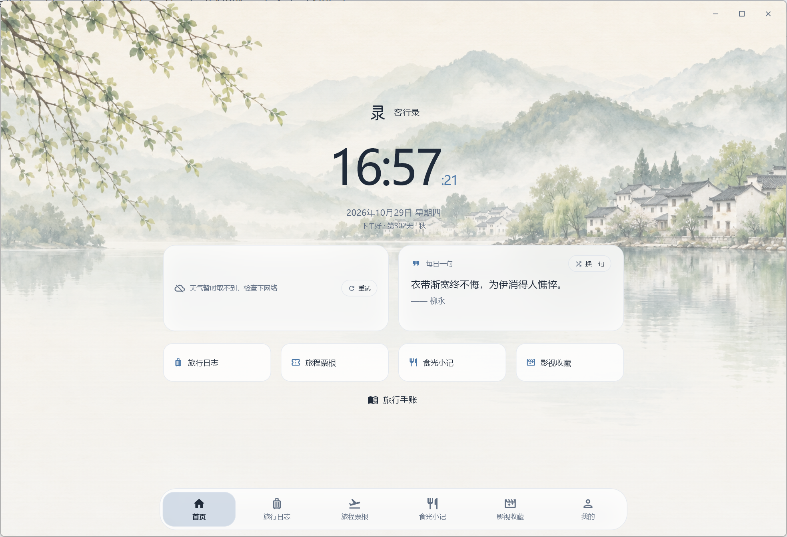

# Waylore · 客行录

把旅途与日常，收进自己的故事里。

[English](README.en.md) · [下载安装包](https://github.com/changanhe/Waylore/releases/tag/v1.0.0) · [支持开发](docs/SUPPORT.md)

## Windows：保留原来的桌面界面

Windows 正式版已恢复为原来的 Python / Flet 客户端：山水背景、大时钟、六项底部导航，以及原有旅行日志、票根、食光、影视和手帐布局。后续以这套界面为基础做局部优化，不用手机布局替代桌面设计。版本保持 **1.0.0**。

Windows 源码入口是根目录 `main.py`，打包使用 `build.py` 和 `build_installer.py`。`mobile/windows/` 保留为未采用的实验实现，不是当前正式 Windows 版本。

## 安卓手机与安卓平板

安卓继续使用 `mobile/` 下的 Flutter 客户端，版本 **1.0.0**、内部构建45。支持旅行与照片、影视与食光、旅行手帐、38款原创图形素材、12种纸张、四种翻页效果、12首内置配乐及MP3导入、悬浮唱片、每日寄语和生日祝福。平板支持双栏、横竖屏和横屏手帐工具栏。

以上安卓功能不表示已经全部移植到 Windows。两个客户端分别保持适合各自设备的布局。

## 下载与数据

- [Windows 安装包](https://github.com/changanhe/Waylore/releases/download/v1.0.0/Kexinglu-Setup-1.0.0.exe)：Windows 10 / 11 x64，原版桌面界面，无需另外安装Python。
- [安卓手机／平板安装包](https://github.com/changanhe/Waylore/releases/download/v1.0.0/Kexinglu-Android-1.0.0.apk)：Android 7及以上，覆盖安装即可更新。
- 发布页附有SHA-256校验文件。此前采用手机布局的Windows便携包已撤下。

原版Windows继续使用原有数据目录，通常位于 `%LOCALAPPDATA%/客行录` 或用户自选位置。退出应用后覆盖安装到原安装位置，不要先卸载或清除数据。若在此前实验Windows界面新增过记录，请先在该界面导出备份；实验版 `%LOCALAPPDATA%/Waylore` 中的数据不会自动并入原版，也不会在此次恢复中删除。

更多说明见[安装与恢复说明](docs/UNIFIED-RELEASE.md)及[验证记录](docs/VALIDATION-1.0.0.md)。

## 开发

Windows：安装 `requirements.txt` 中的依赖后运行 `python main.py`；打包流程见 `build.py` 和 `build_installer.py`。安卓：在VS Code或Android Studio打开 `mobile/`，执行 `flutter pub get` 和 `flutter run`。

用户数据库、签名私钥和本机配置不应提交。可选云服务见 [cloud/SETUP.zh-CN.md](cloud/SETUP.zh-CN.md)。资源许可见 [THIRD_PARTY_NOTICES.md](THIRD_PARTY_NOTICES.md)。

## 一点心意，让故事继续

如果客行录帮你留住了一段旅程、一餐美味，或一个想再看一眼的瞬间，欢迎分享建议，或请开发者喝杯茶。**赞赏完全自愿，不解锁功能，也不影响正常使用。**你的支持会帮助我们继续打磨客行录。

联系与支持：**kexinglu@yeah.net**。
